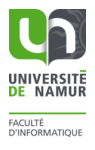
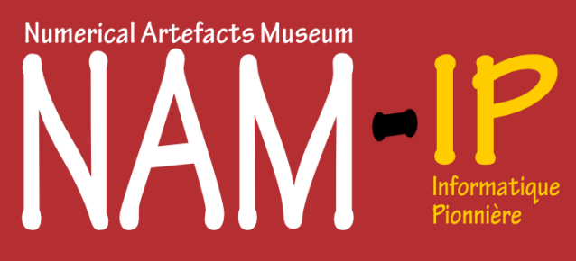

+++
title = "Synergies entre la Faculté d'Informatique de l'UNamur et NAM-IP"
date = 2015-06-30
numero = "2015/2"
ordre = 5
themes = ["Communiqué"]
auteurs = []
series = []
source = "http://pionnier.nam-ip.be/NAM-ip-INFO201502-Communique.html"
+++

     L'Université de Namur (UNamur), à travers sa Faculté d'Informatique (pionnière européenne comme Institut d'enseignement supérieur en informatique) et le Numerical Artefacts Museum-Informatique Pionnière (NAM-IP), musée de l'informatique pionnière en Belgique en cours de création à Salzinnes (Namur), ont créé, ce 14 avril 2015, une *task force* destinée à mettre en œuvre les synergies possibles entre ces deux institutions.

Les deux institutions ont en effet le même souci de conserver les traces de l'histoire de l'informatique en Belgique. L'implantation d'un musée consacré à cette sauvegarde à Namur offre plusieurs opportunités de collaboration sur ce terrain: thèses ou travaux d'étudiants, création de groupes de bénévoles intéressés (retro-programming, restauration d'anciennes machines ou d'anciennes logiques, etc), organisation de conférences ou de colloques sur des thèmes d'histoire de l'informatique (notamment autour de l'inauguration du musée), organisation de visites pour les étudiants, captures de témoignages de pionniers de l'informatique en Belgique, participation à la création d'un Comité scientifique du musée, mise en valeur des travaux pionniers réalisés dans ce domaine par les chercheurs et étudiants de l'UNamur, etc.

Les “logos” des deux institutions seront associés chaque fois qu'une action commune sera décidée et mise en œuvre.

Appel est fait à tout type de collaboration visant à créer une telle synergie.

**Contacts pour la task force:**

● UNamur: Marie d'Udekem-Gevers, Faculté d'Informatique: [marie.gevers@unamur.be](mailto:marie.gevers@unamur.be)

● NAM-IP: R.-Ferdinand Poswick, Administrateur-délégué: [info@nam-ip.be](mailto:info@nam-ip.be)
