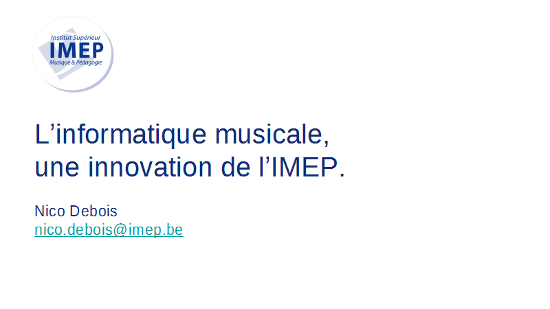
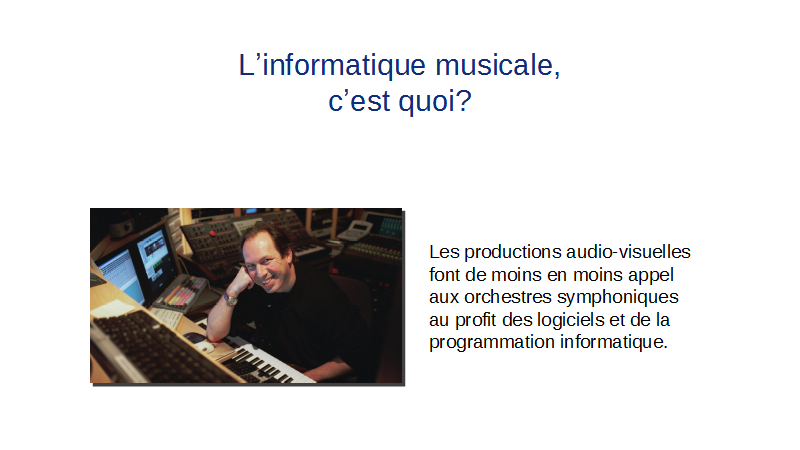
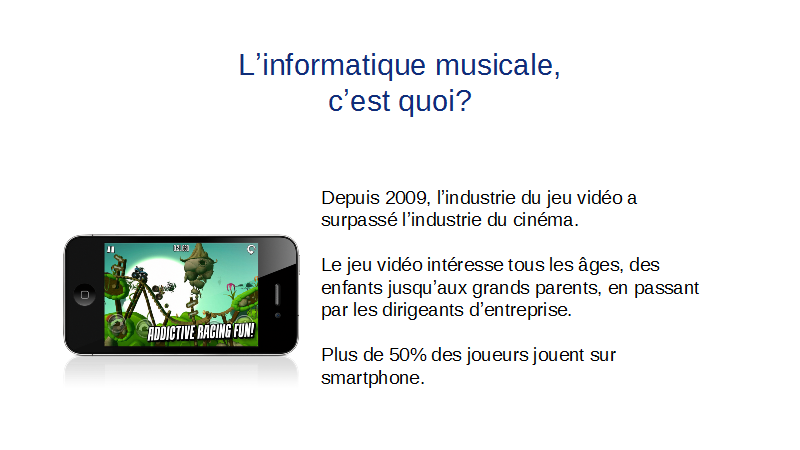
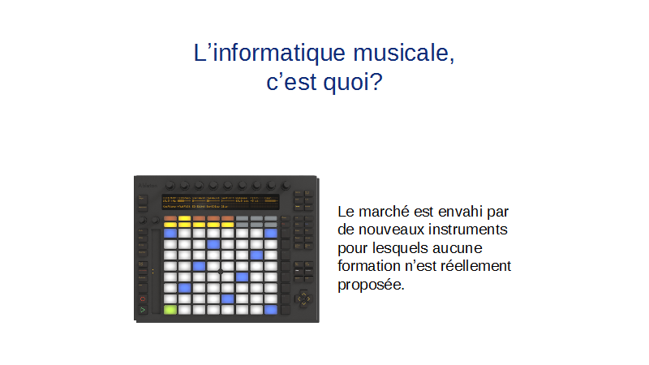
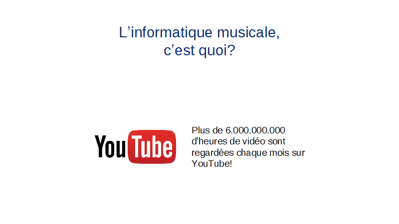
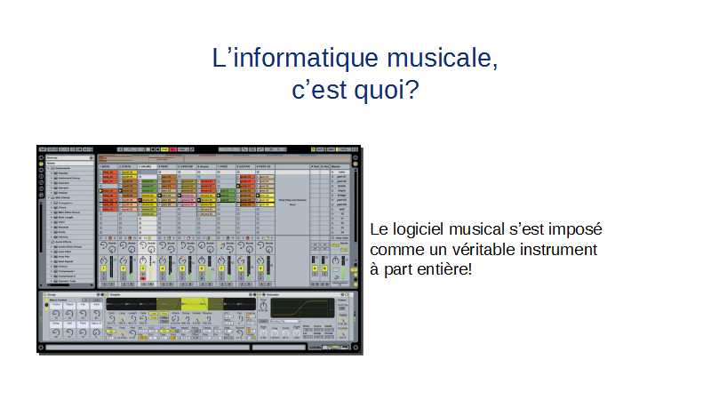
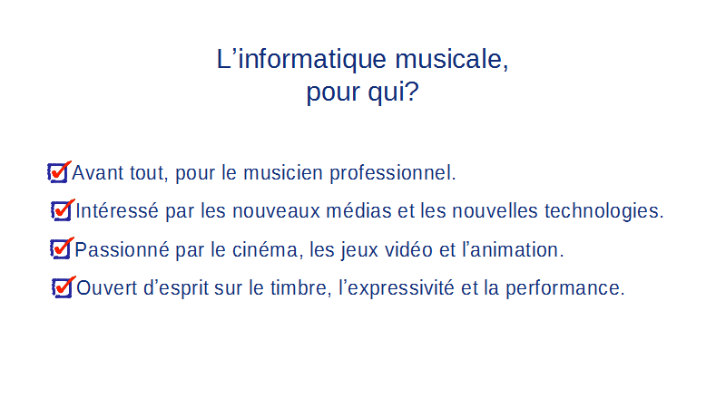
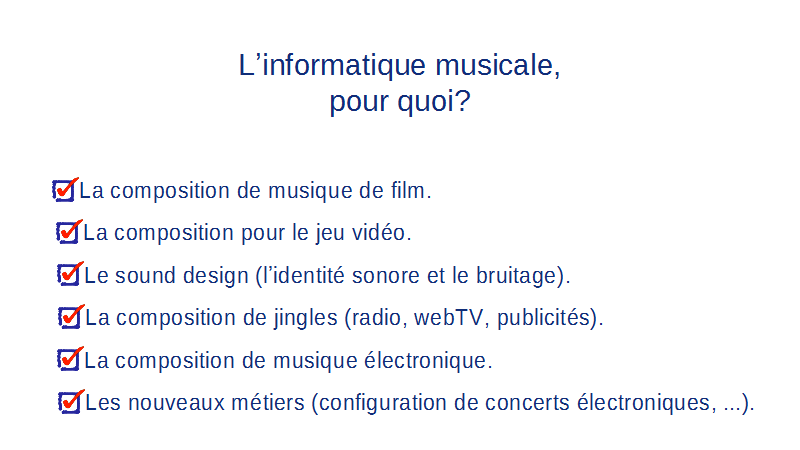
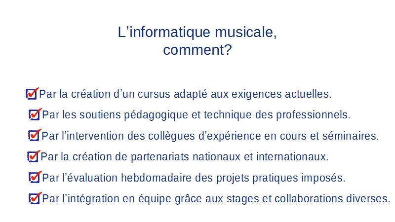
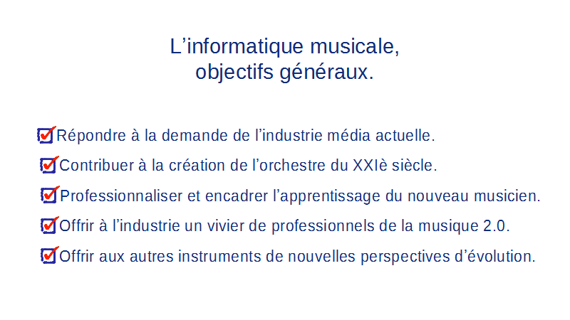

+++
title = "L'informatique musicale, une innovation de l'IMEP"
date = 2017-03-31
numero = "2017/1"
ordre = 10
themes = ["Recherche"]
auteurs = ["N. Debois"]
series = []
source = "http://pionnier.nam-ip.be/NAM-ip-Info201701-Rech5.html"
+++

[Plan du Colloque ▲]()  ## L'informatique musicale, une innovation de l'IMEP (Institut de Musique et de Pédagogie)

Nicolas Debois, Professeur d'informatique musicale

