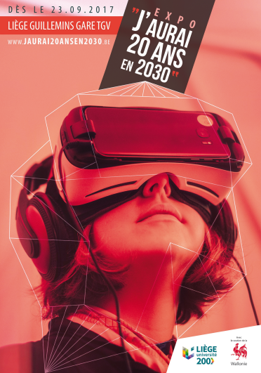

+++
title = "J’aurai 20 ans en 2030"
date = 2017-12-31
numero = "2017/4"
ordre = 6
themes = ["Exposition"]
auteurs = ["R.-Ferdinand Poswick"]
series = []
source = "http://pionnier.nam-ip.be/NAM-ip-INFO201704-Expos3.html"
+++

   Exposition à la Gare des Guillemins (Liège) du 23.09.2017 au 03.06.2018 \
Catalogue de l’exposition, Éditeur responsable: Europa 50, s.c.r.l. -f.s, Imprimé par SNEL, Liège, septembre 2017, 124 pages

Pour les 200 ans de l’Université de Liège, les instances subsidiantes ont mis le paquet (4,5 millions d’Euros, environ) pour présenter, grâce à l’expérience scénographique d’Europa 50 («J’avais 20 ans en ‘45», «Tout Hergé», «Tout Simenon», «Golden sixties», notamment: toutes expositions, depuis 1991 qui ont drainé de 200.000 à 750.000 visiteurs), un parcours étonnant dans le futur de notre civilisation en cours de numérisation!

Le Computer Museum NAM-IP y est représenté à travers le prêt d’une des premières machines à calculer de William Burroughs (1889) présentée sous le regard de Blaise Pascal dont on n’a pu trouver à exposer un modèle de la «pascaline»! Au visiteur de découvrir le joint!

Albert Corhay, Recteur de l’Université présente le propos général de cette luxuriante exposition: «L’avenir n’est pas ce qui va arriver, mais ce que nous allons faire»! (p.6).

Un parcours très visuel pose la plupart des grandes questions auxquelles l’humanité va être confrontée dans les 20 prochaines années… et au-delà! D’abord une Introduction qui évoque le cerveau humain (est-ce le seul siège d’une intelligence vraiment humaine?) et les grands esprits et inventeurs liégeois au milieu des grands inventeurs du monde.

Ensuite, différents chapitres de l’environnement humain sont présentés dans leur dynamique actuelle: l’Habitat, l’Alimentation, les grands Défis de demain, la Mobilité, la Ville, l’Espace, la Médecine (l’homme réparé et l’homme augmenté), l’Éthique.

Des textes très denses sont présentés en français, néerlandais, allemand et anglais. La plupart sont repris en audio-guides, remis d’office à l’entrée, et très bien synchronisés avec les vidéos dans lesquelles un chercheur expose l’argumentaire ou le questionnement de la section d’exposition dans laquelle on s’engage.

Vu l’investissement, la scénographie ne peut être que grandiose: il faut compter deux bonnes heures pour un parcours rapide!

Dans la section sur l’Éthique où l’on tente d’évoquer la façon dont les humains se sont posés la question de la mort et de ce qui se passe ensuite, toute une série de réponses historiques sont évoquées depuis les réducteurs de têtes Jivago jusqu’aux superstitions alchimiques, mais on est étonné de ne pas y trouver l’évocation explicite ni de la ré-incarnation, ni de la résurrection qui peuvent pourtant offrir des pistes fructueuses de réflexion aux penseurs de l’avenir humain!

Les casques de vision en réalité virtuelle qui sont l’image de l’affiche de cette passionnante exposition n’avaient pas encore été livrés au 11 novembre 2017!… une image des décalages prévisionnels à d’autres échelles qui pourraient survenir dans notre avenir?

On souhaite bon succès à cette réalisation dont la localisation dans un niveau d’anciens espaces prévus pour des parkings de la gare des Guillemins, permet évidemment un flot abondant de visiteurs locaux, nationaux et internationaux!

R.-Ferdinand Poswick
{.signature}
